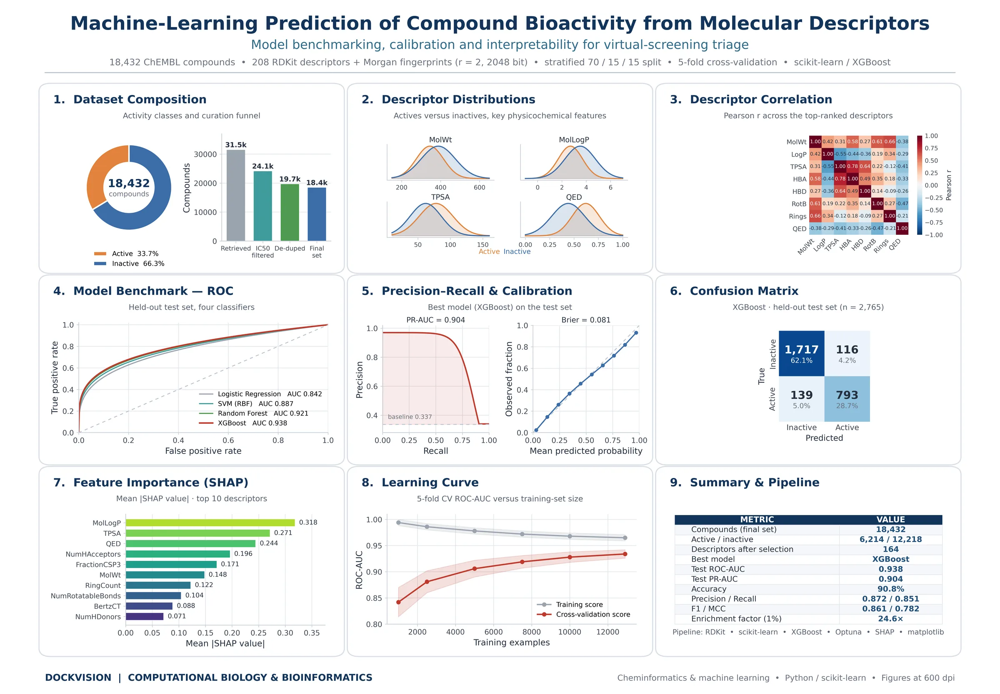

# ML Prediction of Compound Bioactivity

**Area:** Machine Learning & AI

*Machine-learning bioactivity classifier over 18,432 ChEMBL compounds for virtual-screening triage — 208 RDKit descriptors plus Morgan fingerprints, four benchmarked models (XGBoost best, ROC-AUC 0.938), probability calibration, and SHAP feature attribution.*

## The question

Virtual screening produces far more candidates than can be tested. The aim was a classifier that triages compounds by predicted bioactivity.

## What we did

A classifier was trained on 18,432 ChEMBL compounds described by 208 RDKit descriptors plus Morgan fingerprints. Four models were benchmarked, with probability calibration and SHAP feature attribution.

## Tools used

- scikit-learn
- XGBoost
- Optuna
- SHAP
- RDKit

## Key result

XGBoost performed best, with a ROC-AUC of 0.938.

---

Full case study: https://dockvisionbio.com/projects/ml-compound-bioactivity/
