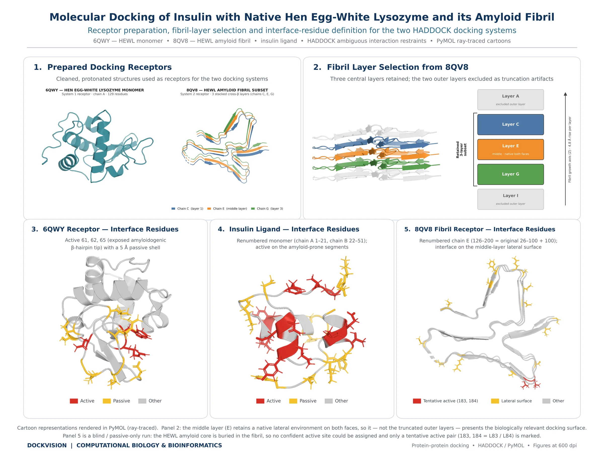

# Insulin–Lysozyme Amyloid Fibril Docking

**Area:** Docking

*HADDOCK protein–protein docking of insulin against native hen egg-white lysozyme (6QWY) and its amyloid fibril (8QV8) — receptor preparation, three-layer fibril selection, and active/passive interface-residue mapping for both systems.*

## The question

How insulin binds native hen egg-white lysozyme (6QWY) compared with its amyloid fibril (8QV8).

## What we did

HADDOCK protein–protein docking for both systems, with receptor preparation, three-layer fibril selection and active/passive interface-residue mapping.

## Tools used

- HADDOCK
- PyMOL

## Key result

Docked complexes and interface-residue maps for the native protein and the fibril.

---

Full case study: https://dockvisionbio.com/projects/insulin-lysozyme-fibril-docking/
