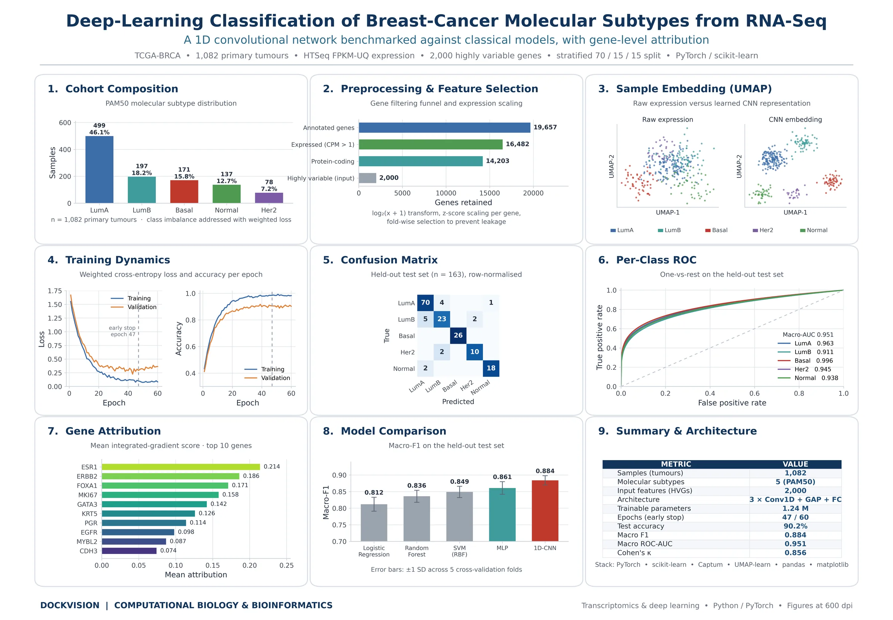

# Deep-Learning Breast-Cancer Subtyping

**Area:** Machine Learning & AI · Genomics, Transcriptomics & Proteomics

*1D convolutional network classifying five PAM50 molecular subtypes from TCGA-BRCA RNA-Seq (1,082 tumours) — leakage-safe gene selection, weighted-loss training with early stopping, 90.2% test accuracy (macro-F1 0.884) beating four classical baselines, and integrated-gradient gene attribution.*

## The question

Classifying the five PAM50 molecular subtypes of breast cancer directly from RNA-Seq expression data.

## What we did

A 1D convolutional network trained on TCGA-BRCA RNA-Seq from 1,082 tumours, with leakage-safe gene selection, weighted-loss training with early stopping, and integrated-gradient gene attribution.

## Tools used

- PyTorch
- Captum

## Key result

90.2% test accuracy (macro-F1 0.884), beating four classical baselines.

---

Full case study: https://dockvisionbio.com/projects/deep-learning-breast-cancer-subtyping/
