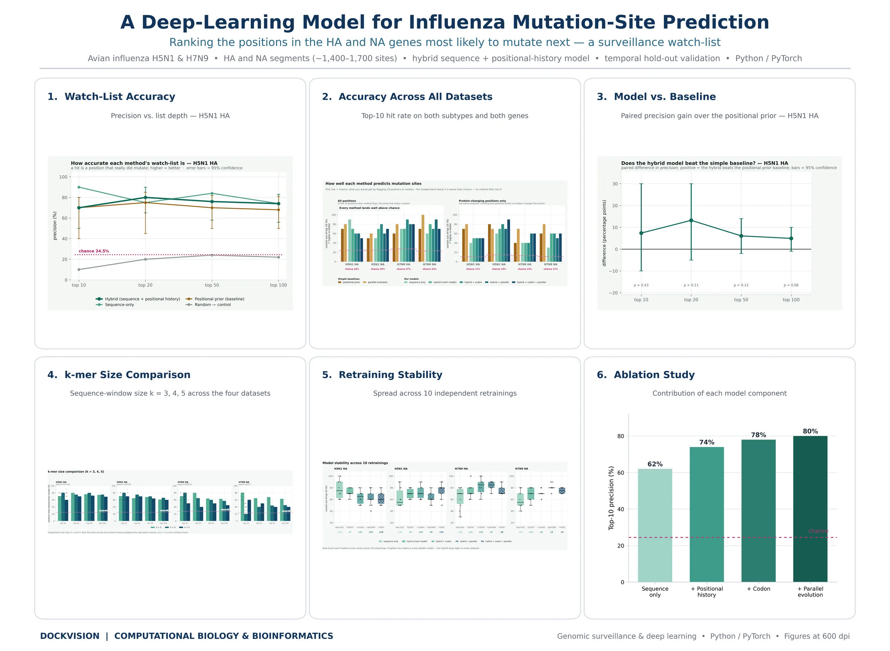

# Deep-Learning Influenza Mutation-Site Prediction

**Area:** Machine Learning & AI

*Hybrid sequence + positional-history deep-learning model that ranks the HA and NA gene positions of avian influenza H5N1 & H7N9 most likely to mutate next — a genomic-surveillance watch-list validated on temporal hold-out data, benchmarked against a positional-prior baseline (80% top-10 precision vs 24.5% chance), with k-mer, retraining-stability and ablation analyses.*

## The question

Genomic surveillance of avian influenza H5N1 and H7N9 needs a watch-list of the HA and NA gene positions most likely to mutate next.

## What we did

A hybrid sequence and positional-history deep-learning model, validated on temporal hold-out data and benchmarked against a positional-prior baseline, with k-mer, retraining-stability and ablation analyses.

## Tools used

- Python
- PyTorch

## Key result

80% top-10 precision, against 24.5% by chance.

---

Full case study: https://dockvisionbio.com/projects/influenza-mutation-site-prediction/
