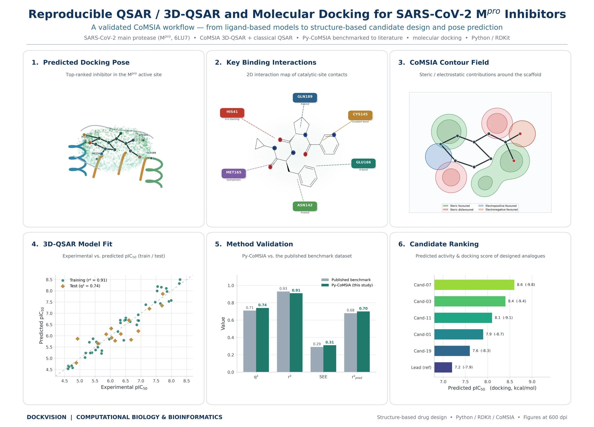

# QSAR / 3D-QSAR & Docking of SARS-CoV-2 Mpro Inhibitors

**Area:** Docking · Machine Learning & AI

*Reproducible CoMSIA 3D-QSAR and classical QSAR workflow for SARS-CoV-2 main-protease inhibitors (PDB: 6LU7) — training r² 0.91 / test q² 0.74, Py-CoMSIA benchmarked against the published dataset, steric and electrostatic contour fields, designed-analogue ranking by predicted pIC50, and docking poses mapping key catalytic-site contacts (His41, Cys145, Glu166).*

## The question

A reproducible QSAR workflow for inhibitors of the SARS-CoV-2 main protease (PDB: 6LU7), able to rank newly designed analogues.

## What we did

CoMSIA 3D-QSAR and classical QSAR, with Py-CoMSIA benchmarked against the published dataset, steric and electrostatic contour fields, analogue ranking by predicted pIC50, and docking poses mapping the catalytic-site contacts His41, Cys145 and Glu166.

## Tools used

- Python
- RDKit
- CoMSIA

## Key result

Training r² of 0.91 and test q² of 0.74.

---

Full case study: https://dockvisionbio.com/projects/qsar-docking-sars-cov-2-mpro/
