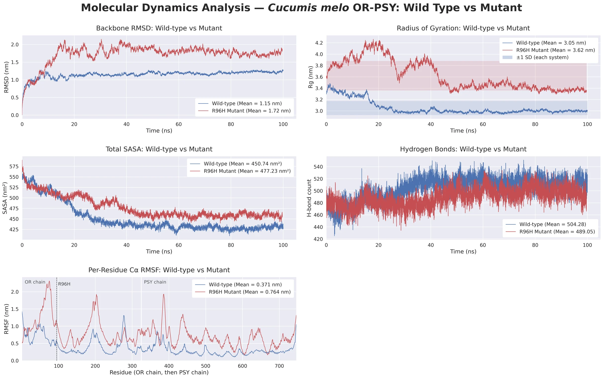

# Cucumis melo OR–PSY MD: WT vs R96H

**Area:** MD Simulation

*Comparative 100 ns all-atom MD of the Cucumis melo OR–PSY heterodimer, wild-type versus the R96H mutant — backbone RMSD, radius of gyration, total SASA, intramolecular H-bonds, and per-residue Cα RMSF showing mutant destabilisation.*

## The question

Whether the R96H mutation changes the stability of the Cucumis melo OR–PSY heterodimer.

## What we did

Comparative 100 ns all-atom molecular dynamics of the wild-type and mutant complexes: backbone RMSD, radius of gyration, total SASA, intramolecular H-bonds and per-residue Cα RMSF.

## Tools used

- GROMACS
- Python

## Key result

The analysis shows destabilisation of the mutant.

---

Full case study: https://dockvisionbio.com/projects/or-psy-md-wild-type-vs-r96h/
