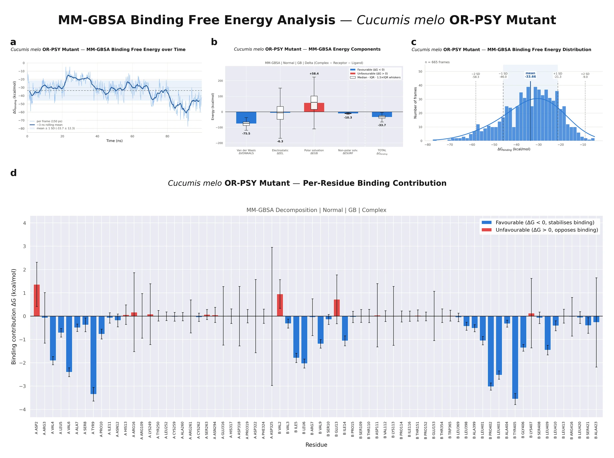

# MM-GBSA Binding Free Energy: Cucumis melo OR–PSY Mutant

**Area:** MD Simulation · Data Science (Python & R)

*MM-GBSA binding free energy analysis of the Cucumis melo OR–PSY mutant complex — binding energy over time, energy components, the binding energy distribution, and per-residue binding contributions.*

## The question

How strongly the two chains of the Cucumis melo OR–PSY mutant complex bind, and which residues drive the interaction.

## What we did

MM-GBSA binding free energy calculated across the trajectory, with the energy components, the distribution of binding energies and a per-residue decomposition, assembled into one four-part figure.

## Tools used

- MM-GBSA
- Python

## Key result

A single panel showing binding energy over time, its components and distribution, and the favourable and unfavourable residues.

---

Full case study: https://dockvisionbio.com/projects/mm-gbsa-or-psy-mutant/
