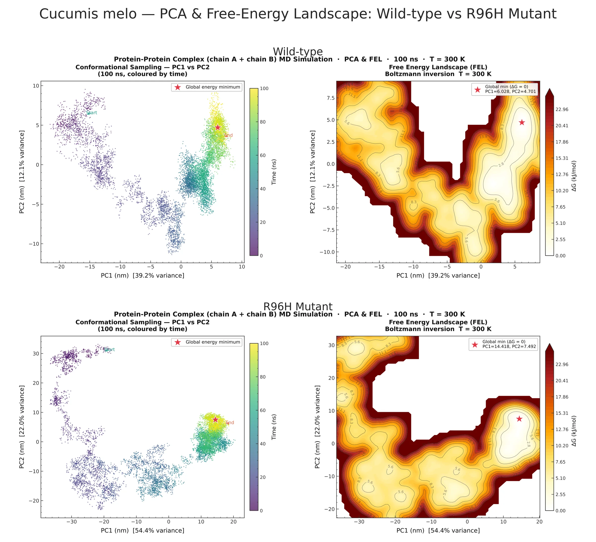

# OR–PSY PCA & Free Energy Landscape

**Area:** MD Simulation

*Essential-dynamics comparison of the wild-type and R96H OR–PSY complexes — PC1/PC2 conformational sampling coloured by time and Boltzmann-inverted free energy landscapes at 300 K, locating each system's global energy minimum.*

## The question

How the conformational sampling of the wild-type and R96H OR–PSY complexes differs.

## What we did

Essential-dynamics analysis: PC1/PC2 conformational sampling coloured by time, and Boltzmann-inverted free energy landscapes at 300 K.

## Tools used

- PCA
- Free Energy Landscape

## Key result

Each system's global energy minimum was located.

---

Full case study: https://dockvisionbio.com/projects/or-psy-pca-free-energy-landscape/
