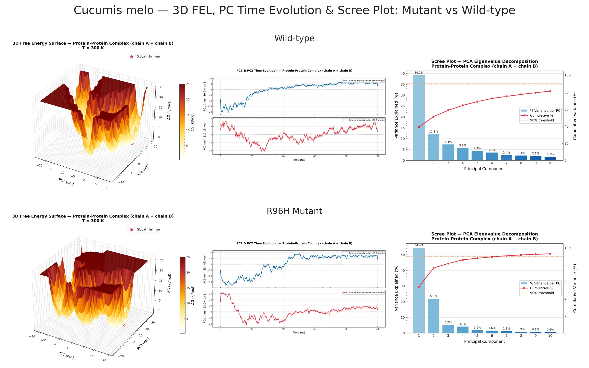

# OR–PSY 3D FEL & PCA Scree Analysis

**Area:** MD Simulation

*Extended essential-dynamics analysis of the OR–PSY systems — 3D free-energy surfaces, PC1/PC2 time evolution with running means, and eigenvalue scree plots quantifying how much motion the mutation collapses into the first component.*

## The question

Quantifying how the mutation redistributes motion in the OR–PSY systems.

## What we did

Extended essential dynamics: 3D free-energy surfaces, PC1/PC2 time evolution with running means, and eigenvalue scree plots.

## Tools used

- PCA
- Free Energy Landscape

## Key result

The scree plots quantify how much motion the mutation collapses into the first component.

---

Full case study: https://dockvisionbio.com/projects/or-psy-3d-fel-scree-analysis/
