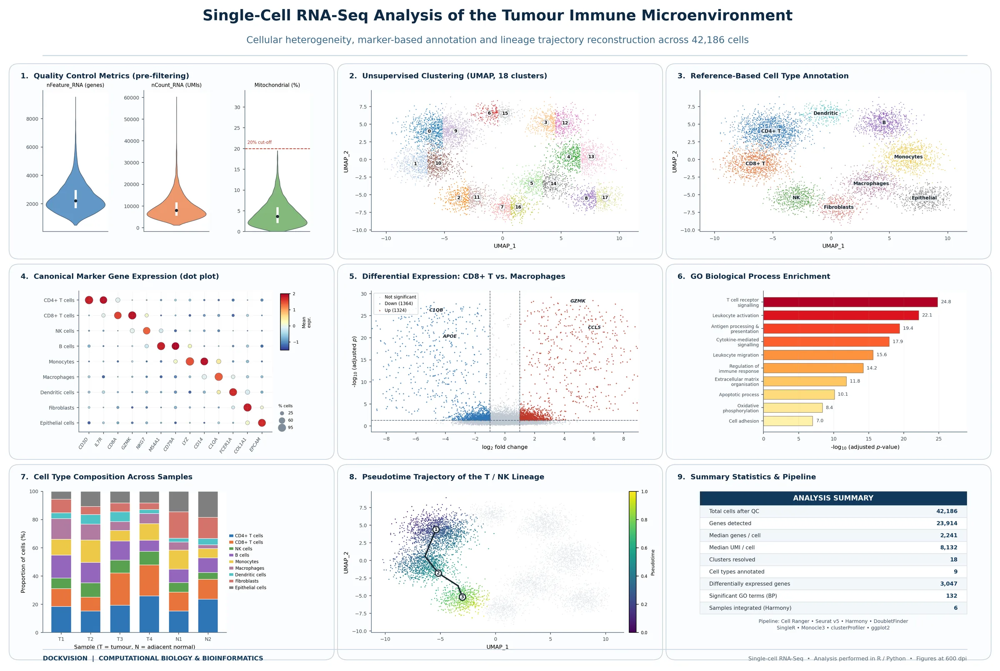

# Single-Cell RNA-Seq Cellular Atlas

**Area:** Genomics, Transcriptomics & Proteomics · Machine Learning & AI

*End-to-end single-cell RNA-seq of 52,000+ cells — QC filtering, UMAP clustering, cell-type annotation, marker-gene profiling, GO/KEGG enrichment, pseudotime, RNA velocity, and cell–cell communication.*

## The question

Building a cellular atlas from a single-cell RNA-seq dataset of more than 52,000 cells.

## What we did

End-to-end analysis: QC filtering, UMAP clustering, cell-type annotation, marker-gene profiling, GO/KEGG enrichment, pseudotime, RNA velocity and cell–cell communication.

## Tools used

- Seurat v5
- Harmony
- Monocle3
- CellChat

## Key result

An annotated atlas with marker genes, enriched pathways, trajectories and communication networks.

---

Full case study: https://dockvisionbio.com/projects/single-cell-rna-seq-atlas/
