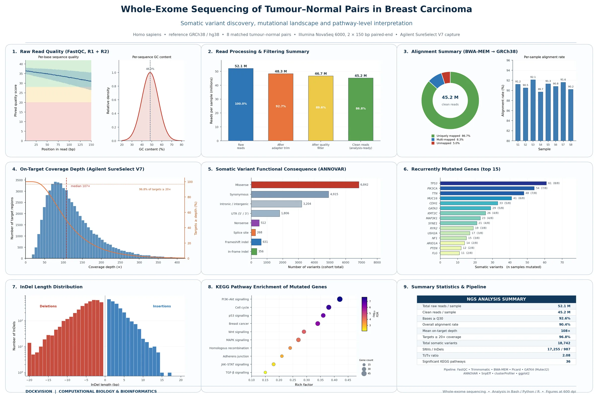

# NGS Cancer Genomics — TNBC Drivers

**Area:** Genomics, Transcriptomics & Proteomics

*Comprehensive NGS somatic analysis of triple-negative breast cancer (TCGA-BRCA) — read QC, variant calling, tumor mutation burden, oncoplot, copy-number variation, COSMIC mutational signatures, KEGG pathways, PPI network, and Kaplan–Meier survival.*

## The question

Identifying the somatic drivers of triple-negative breast cancer in TCGA-BRCA data.

## What we did

Read QC, variant calling, tumor mutation burden, oncoplot, copy-number variation, COSMIC mutational signatures, KEGG pathways, PPI network and Kaplan–Meier survival analysis.

## Tools used

- Variant calling
- COSMIC signatures
- KEGG

## Key result

A comprehensive somatic profile, from variants to pathways and survival.

---

Full case study: https://dockvisionbio.com/projects/ngs-cancer-genomics-tnbc/
