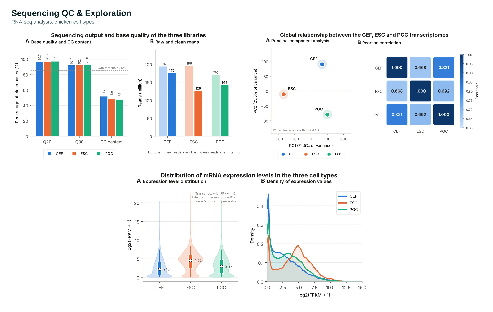

# RNA-seq Analysis, Chicken Cell Types: Sequencing QC & Exploration

**Area:** Genomics, Transcriptomics & Proteomics · Data Science (Python & R)

*Quality control and exploratory analysis of RNA-seq libraries from three chicken cell types — base quality and GC content, raw versus clean reads, principal component analysis, sample correlation, and expression-level distributions.*

## The question

Before any comparison between cell types, the sequencing libraries had to be checked for quality and for how the samples relate to each other.

## What we did

Base quality (Q20/Q30) and GC content, raw and clean read counts, principal component analysis, Pearson correlation between samples, and the distribution of expression values, combined into one panel.

## Tools used

- RNA-seq
- R Studio
- Python

## Key result

A three-figure panel confirming library quality and showing how the three cell types separate.

---

Full case study: https://dockvisionbio.com/projects/rna-seq-chicken-cell-types-qc-exploration/
