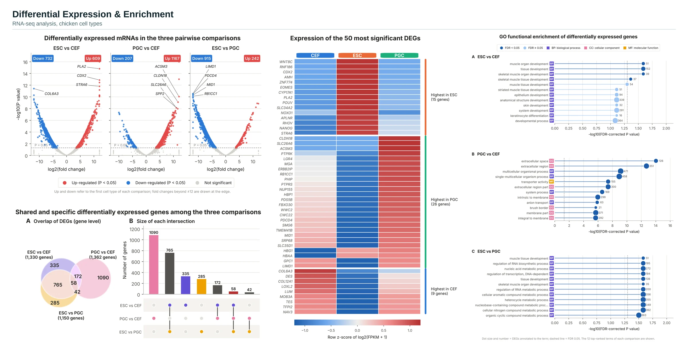

# RNA-seq Analysis, Chicken Cell Types: Differential Expression & Enrichment

**Area:** Genomics, Transcriptomics & Proteomics · Data Science (Python & R)

*Differential expression across three pairwise comparisons of chicken cell types — volcano plots, the overlap of differentially expressed genes, GO functional enrichment, and a heatmap of the 50 most significant genes.*

## The question

Which genes differ between the three cell types, how much the comparisons share, and which biological functions those genes point to.

## What we did

Differential expression for each pairwise comparison shown as volcano plots, a Venn and intersection plot of the gene sets, GO functional enrichment, and a clustered heatmap of the 50 most significant genes.

## Tools used

- RNA-seq
- GO enrichment
- R Studio
- Python

## Key result

A four-figure panel that takes the reader from the differentially expressed genes to their shared patterns and enriched functions.

---

Full case study: https://dockvisionbio.com/projects/rna-seq-chicken-cell-types-differential-expression/
