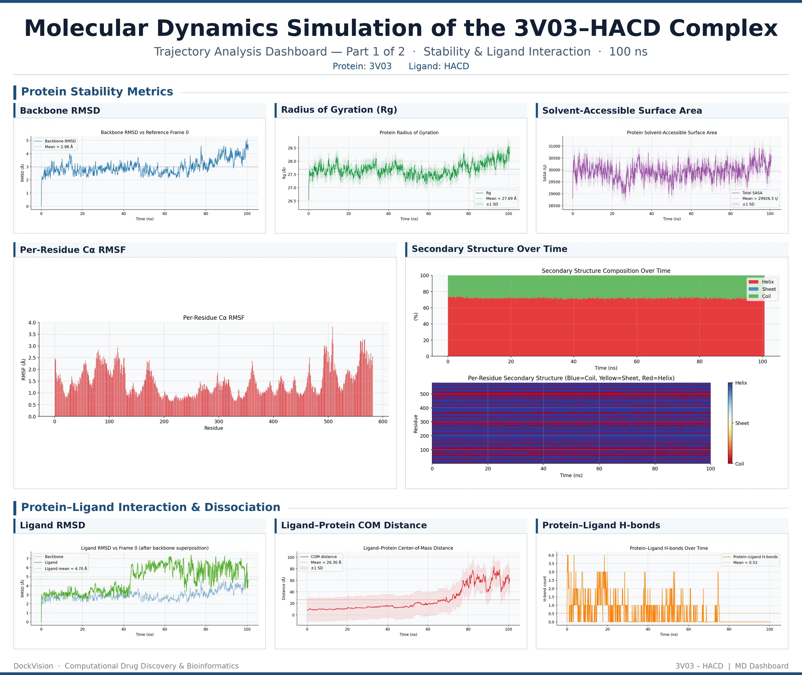

# 3V03 HACD MD Dashboard – Part 1

**Area:** MD Simulation

*MD simulation dashboard for 3V03 HACD complex — Part 1: RMSD, RMSF, radius of gyration, and SASA metrics plotted over the full simulation trajectory.*

## The question

Summarising the stability of the 3V03 HACD complex across a full simulation.

## What we did

RMSD, RMSF, radius of gyration and SASA plotted over the full trajectory, presented as a single dashboard.

## Tools used

- MD trajectory analysis

## Key result

A one-page view of the core stability metrics.

---

Full case study: https://dockvisionbio.com/projects/3v03-hacd-md-dashboard-part-1/
