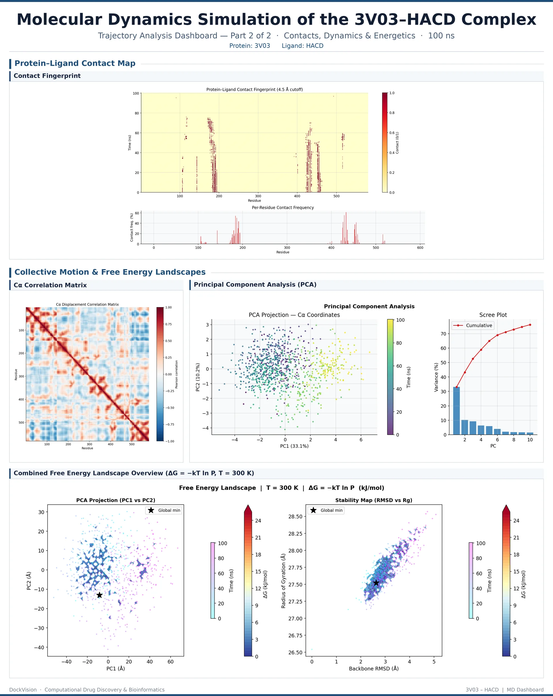

# 3V03 HACD MD Dashboard – Part 2

**Area:** MD Simulation

*MD simulation dashboard for 3V03 HACD complex — Part 2: H-bond analysis, cluster distribution, free energy landscape, and binding pocket stability.*

## The question

Characterising binding in the 3V03 HACD complex beyond the core stability metrics.

## What we did

H-bond analysis, cluster distribution, free energy landscape and binding-pocket stability.

## Tools used

- MD trajectory analysis
- Free Energy Landscape

## Key result

The second half of the dashboard, covering interactions and energetics.

---

Full case study: https://dockvisionbio.com/projects/3v03-hacd-md-dashboard-part-2/
