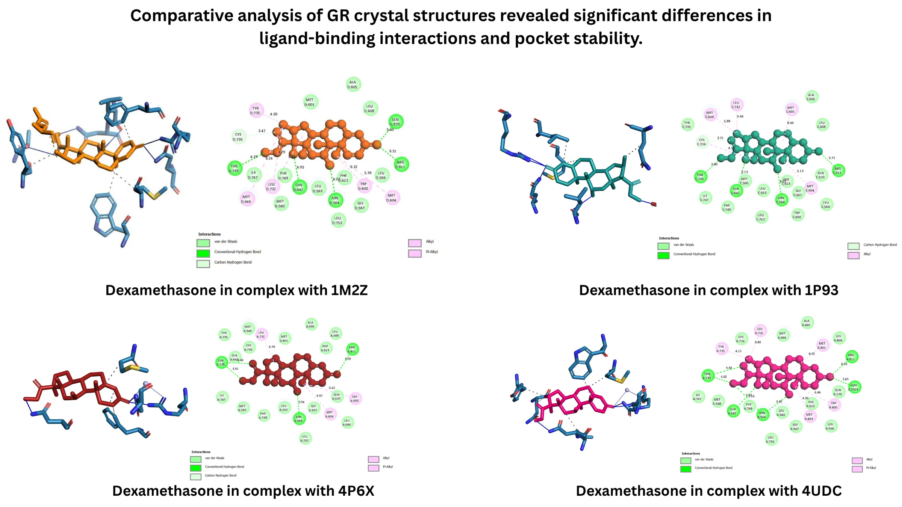

# Carmofur–Mpro 3D Binding Structure

**Area:** Docking

*Publication-ready 3D visualization of Carmofur bound to SARS-CoV-2 main protease active site (PDB: 6LU7), showing all key molecular interactions.*

## The question

Showing clearly how Carmofur sits in the active site of the SARS-CoV-2 main protease (PDB: 6LU7).

## What we did

3D visualization of the bound complex with all key molecular interactions shown.

## Tools used

- Molecular docking
- 3D visualization

## Key result

A publication-ready 3D binding figure.

---

Full case study: https://dockvisionbio.com/projects/carmofur-mpro-3d-binding/
