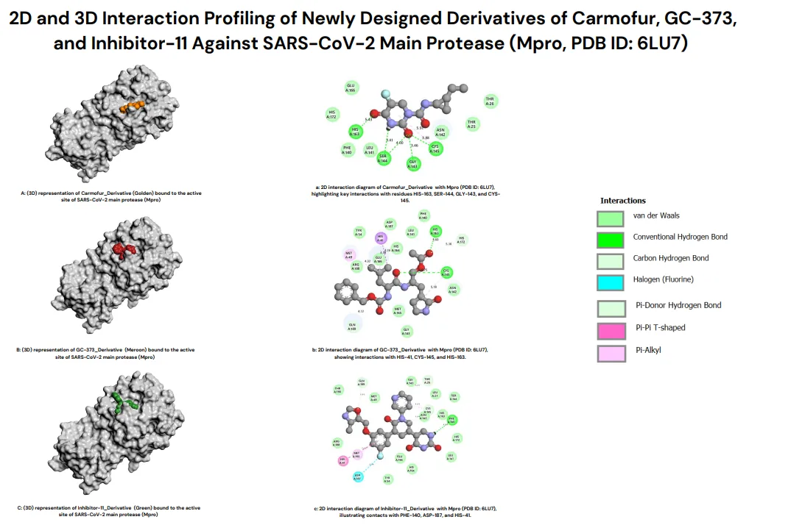

# SARS-CoV-2 Mpro Inhibitor Profiling

**Area:** Docking

*2D and 3D interaction profiling of Carmofur & GC-373 derivatives against SARS-CoV-2 main protease (PDB: 6LU7) — multi-compound comparative study.*

## The question

Comparing how Carmofur and GC-373 derivatives interact with the SARS-CoV-2 main protease (PDB: 6LU7).

## What we did

2D and 3D interaction profiling of each compound in a multi-compound comparative study.

## Tools used

- Molecular docking
- 2D/3D interaction maps

## Key result

Side-by-side interaction profiles for the derivative series.

---

Full case study: https://dockvisionbio.com/projects/sars-cov-2-mpro-inhibitor-profiling/
