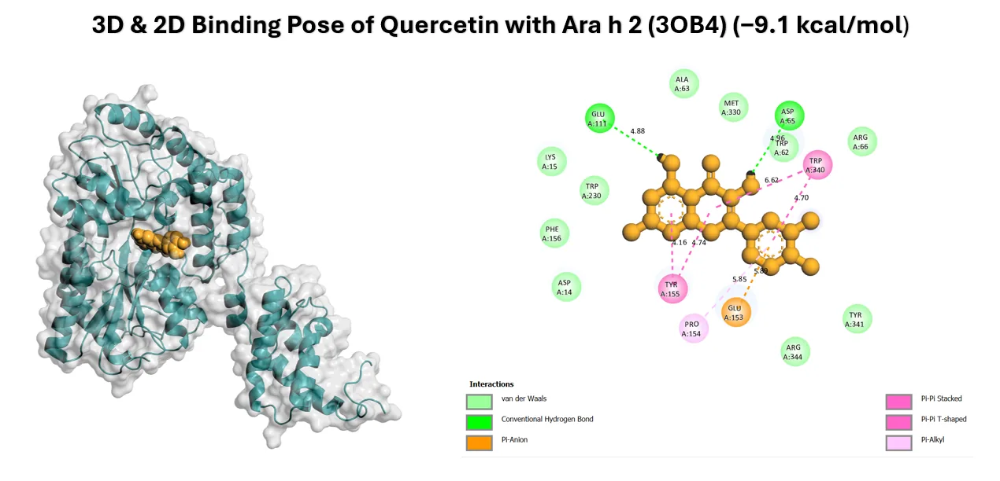

# Quercetin–Ara h 2 Binding Analysis

**Area:** Docking

*3D & 2D binding pose of Quercetin with Ara h 2 allergen protein (PDB: 3OB4), mapping hydrogen bonds and hydrophobic contacts for allergy research.*

## The question

How Quercetin binds the Ara h 2 allergen protein (PDB: 3OB4), for allergy research.

## What we did

3D and 2D binding-pose analysis, mapping hydrogen bonds and hydrophobic contacts.

## Tools used

- Molecular docking
- 2D/3D interaction maps

## Key result

A mapped binding pose with its key contacts.

---

Full case study: https://dockvisionbio.com/projects/quercetin-ara-h-2-binding/
