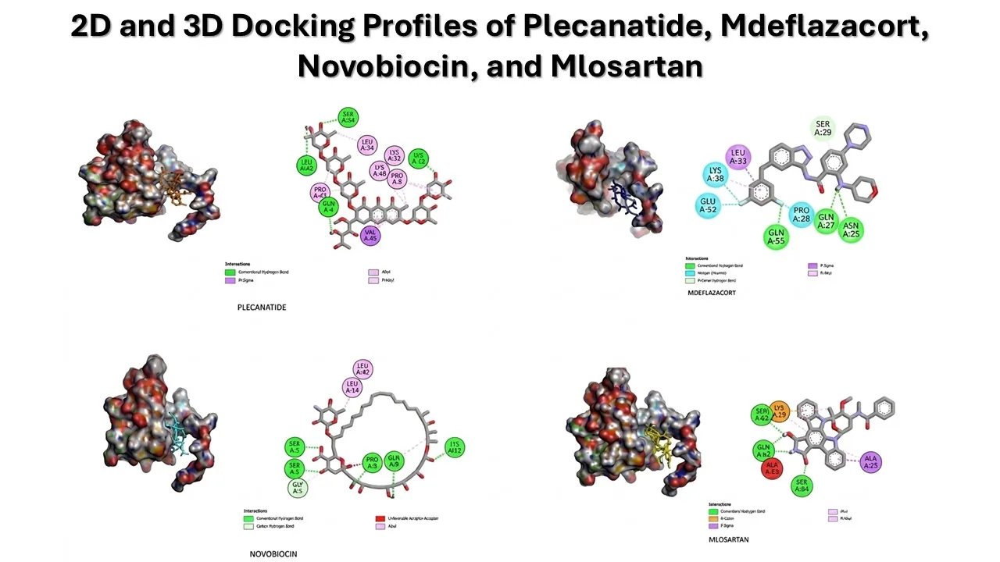

# Multi-Drug 2D/3D Docking Profiles

**Area:** Docking

*Comprehensive 2D & 3D docking profiles of Plecanatide, Mdeflazacort, Novobiocin, and Mlosartan — complete interaction mapping for publication.*

## The question

Presenting docking results for four drugs in one consistent, publishable format.

## What we did

2D and 3D docking profiles of Plecanatide, Mdeflazacort, Novobiocin and Mlosartan, with complete interaction mapping.

## Tools used

- Molecular docking
- 2D/3D interaction maps

## Key result

A complete set of interaction maps ready for publication.

---

Full case study: https://dockvisionbio.com/projects/multi-drug-docking-profiles/
