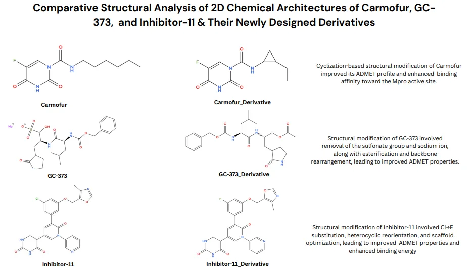

# Drug Derivative Structural Analysis

**Area:** Docking

*Comparative 2D chemical architecture of Carmofur, GC-373, and Inhibitor-11 with newly designed derivatives — ADMET and binding affinity improvement.*

## The question

Comparing newly designed derivatives with their parent compounds Carmofur, GC-373 and Inhibitor-11.

## What we did

Comparative 2D chemical architecture of parents and derivatives, assessed for ADMET and binding affinity.

## Tools used

- ADMET profiling
- 2D structure analysis

## Key result

A structural comparison focused on ADMET and binding-affinity improvement.

---

Full case study: https://dockvisionbio.com/projects/drug-derivative-structural-analysis/
