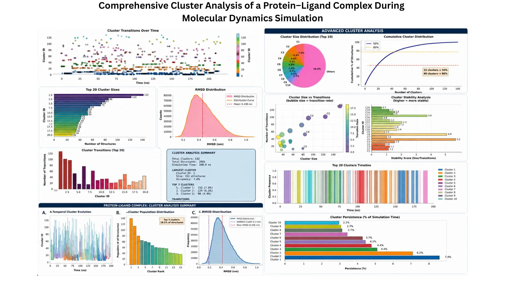

# Protein–Ligand Cluster Analysis (200 ns)

**Area:** Data Science (Python & R)

*Comprehensive cluster analysis over 200 ns MD simulation — 132 total clusters, RMSD distribution, cluster stability scoring and population timeline.*

## The question

Understanding the conformational states visited by a protein–ligand complex over 200 ns.

## What we did

Cluster analysis of the trajectory with RMSD distribution, cluster stability scoring and a population timeline.

## Tools used

- R Studio
- Python

## Key result

132 clusters identified and characterised.

---

Full case study: https://dockvisionbio.com/projects/protein-ligand-cluster-analysis-200ns/
