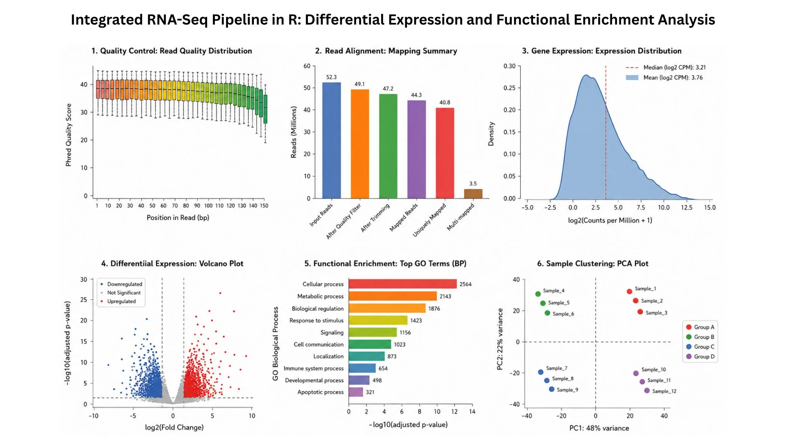

# Advanced MD Cluster Distribution

**Area:** Data Science (Python & R)

*Cluster size distribution, cumulative analysis, bubble chart of transitions, and top-20 cluster persistence over the full simulation time.*

## The question

Describing how conformational clusters are distributed and how long they persist.

## What we did

Cluster size distribution, cumulative analysis, a bubble chart of transitions, and top-20 cluster persistence over the full simulation time.

## Tools used

- R Studio

## Key result

A four-panel view of cluster populations and transitions.

---

Full case study: https://dockvisionbio.com/projects/advanced-md-cluster-distribution/
