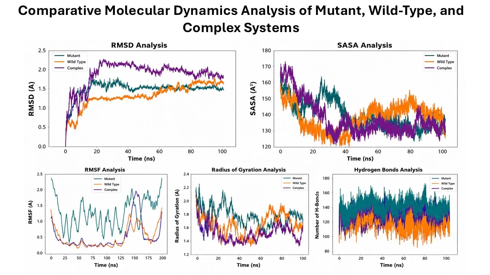

# Comparative MD: Mutant vs Wild-Type

**Area:** MD Simulation

*Comparative MD of Mutant, Wild-Type, and Complex systems — RMSD, RMSF, SASA, radius of gyration, and H-bond metrics over 100 ns.*

## The question

Comparing the dynamics of mutant, wild-type and complex systems.

## What we did

RMSD, RMSF, SASA, radius of gyration and H-bond metrics for each system over 100 ns.

## Tools used

- MD trajectory analysis

## Key result

A direct comparison of the three systems across the standard stability metrics.

---

Full case study: https://dockvisionbio.com/projects/comparative-md-mutant-vs-wild-type/
