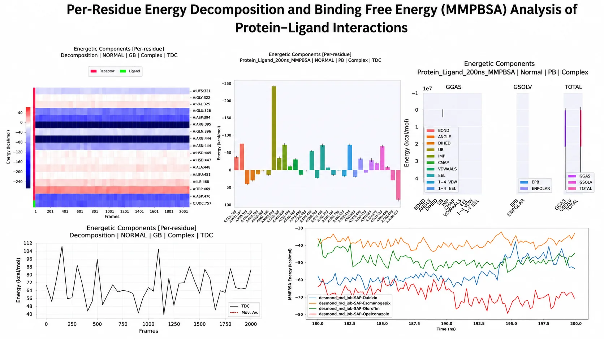

# MM-PBSA Binding Free Energy Analysis

**Area:** MD Simulation

*Per-residue energy decomposition and MM-PBSA binding free energy of protein-ligand interactions — GGAS, GSOLV, and TOTAL components.*

## The question

Quantifying binding strength in a protein–ligand complex and identifying which residues contribute.

## What we did

MM-PBSA binding free energy with per-residue energy decomposition, reporting the GGAS, GSOLV and TOTAL components.

## Tools used

- MM-PBSA

## Key result

Binding free energy broken down by component and by residue.

---

Full case study: https://dockvisionbio.com/projects/mm-pbsa-binding-free-energy/
