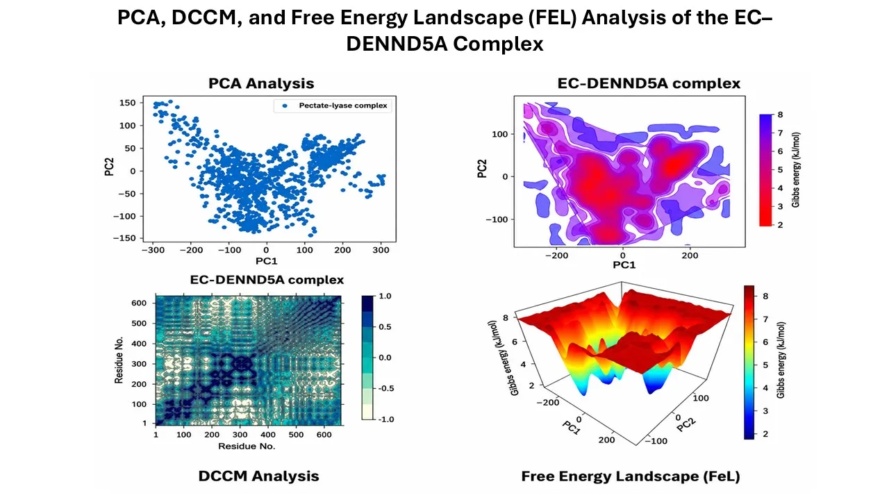

# PCA, DCCM & Free Energy Landscape

**Area:** MD Simulation

*Advanced trajectory analysis: PCA scatter, Dynamic Cross-Correlation Matrix (DCCM), and 3D Free Energy Landscape for a protein complex.*

## The question

Characterising the collective motions of a protein complex.

## What we did

Advanced trajectory analysis: PCA scatter, Dynamic Cross-Correlation Matrix (DCCM) and a 3D free energy landscape.

## Tools used

- PCA
- DCCM
- Free Energy Landscape

## Key result

Correlated motions and low-energy states mapped for the complex.

---

Full case study: https://dockvisionbio.com/projects/pca-dccm-free-energy-landscape/
