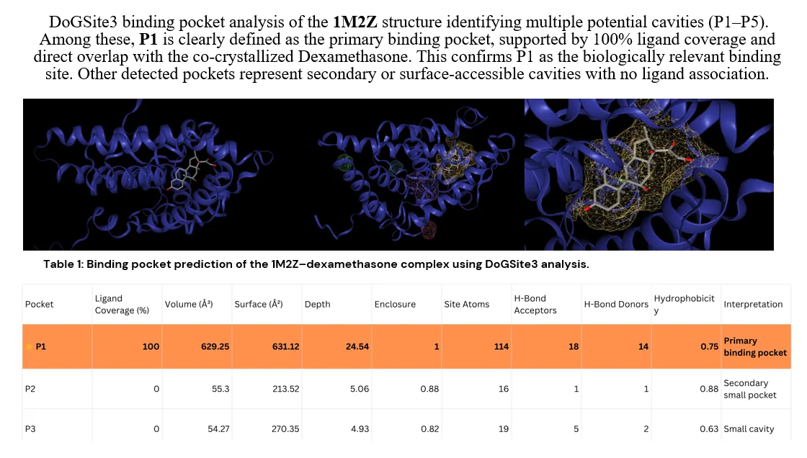

# DoGSite3 Binding Pocket Prediction

**Area:** Data Science (Python & R)

*DoGSite3 binding pocket analysis of 1MIZ structure — primary druggable cavities identified with volumetric data and drughunter scoring.*

## The question

Finding the druggable cavities of the 1MIZ structure.

## What we did

DoGSite3 binding-pocket analysis with volumetric data and druggability scoring.

## Tools used

- DoGSite3

## Key result

The primary druggable cavities were identified.

---

Full case study: https://dockvisionbio.com/projects/dogsite3-binding-pocket-prediction/
