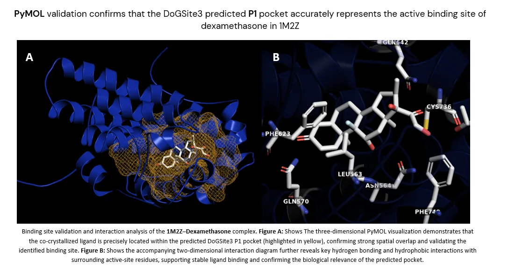

# PyMOL Binding Pocket Validation

**Area:** Data Science (Python & R)

*PyMOL validation of DoGSite3-predicted P1 pocket on the 1MIZ-dexamethasone complex, confirmed by co-crystallized ligand overlay.*

## The question

Checking that the predicted P1 pocket on 1MIZ is a real binding site.

## What we did

PyMOL validation on the 1MIZ–dexamethasone complex, overlaying the co-crystallized ligand.

## Tools used

- PyMOL
- DoGSite3

## Key result

The predicted pocket was confirmed by the ligand overlay.

---

Full case study: https://dockvisionbio.com/projects/pymol-binding-pocket-validation/
